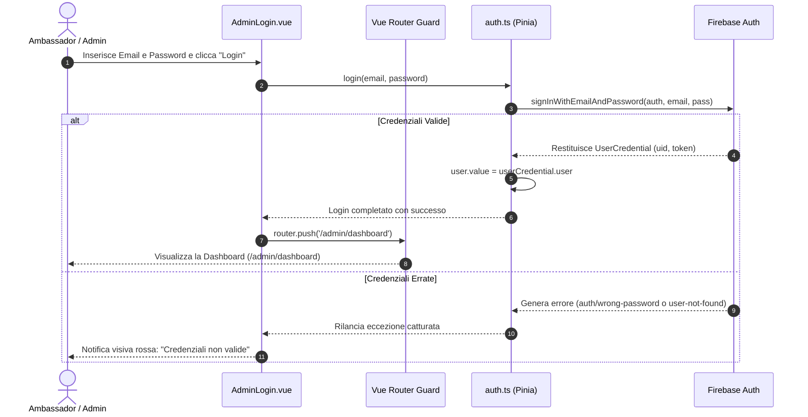

# 🔐 Flusso 01 — Autenticazione & Sessione Admin

Questo documento descrive il ciclo di vita dell'autenticazione, la protezione delle rotte della dashboard e la gestione della sessione.

---

## 📍 Dove si trova il codice

| Elemento | Percorso File | Ruolo Principale |
| :--- | :--- | :--- |
| **Pagina di Login** | [src/pages/admin/AdminLogin.vue](file:///home/chif-vas/projects/beauty-ambassador/src/pages/admin/AdminLogin.vue) | Form di accesso con email e password, dialog recupero password. |
| **Layout Dedicato** | [src/layouts/BlankLayout.vue](file:///home/chif-vas/projects/beauty-ambassador/src/layouts/BlankLayout.vue) | Layout minimalista senza menu laterale per la schermata di login. |
| **Store Pinia** | [src/stores/auth.ts](file:///home/chif-vas/projects/beauty-ambassador/src/stores/auth.ts) | Gestione stato utente reattivo (`user`, `isAuthenticated`), chiamate Firebase Auth. |
| **Boot Inizializzazione** | [src/boot/auth-init.ts](file:///home/chif-vas/projects/beauty-ambassador/src/boot/auth-init.ts) | Listener `onAuthStateChanged` avviato prima del mount dell'app. |
| **Router & Guard** | [src/router/index.ts](file:///home/chif-vas/projects/beauty-ambassador/src/router/index.ts) | Intercettazione delle navigazioni protette con `meta: { requiresAuth: true }`. |
| **Logger Sicuro** | [src/shared/logger.ts](file:///home/chif-vas/projects/beauty-ambassador/src/shared/logger.ts) | Tracciamento eventi di login/logout con oscuramento automatico delle email (PII). |

---

## 🔄 Diagramma di Sequenza del Flusso di Login

---

## 🛡️ Dettaglio della Logica di Sicurezza

### 1. Inizializzazione e Persistenza della Sessione
Quando l'utente aggiorna la pagina (F5) o riapre il browser:
* In [auth-init.ts](file:///home/chif-vas/projects/beauty-ambassador/src/boot/auth-init.ts) viene registrato l'observer `onAuthStateChanged(auth, ...)`.
* Se un token JWT valido è presente in `IndexedDB`/`LocalStorage`, Firebase ripristina istantaneamente l'oggetto `user` nello store senza richiedere un nuovo login.

### 2. Protezione delle Rotte (`router/index.ts`)
Nel `Router.beforeEach`:
1. Verifica se la rotta di destinazione richiede autenticazione (`to.matched.some(r => r.meta.requiresAuth)`).
2. Se `requiresAuth === true` e `authStore.isAuthenticated === false`, la navigazione viene bloccata e reindirizzata a `/admin/login`.
3. Se l'utente è **già autenticato** e prova a visitare `/admin/login`, viene automaticamente inoltrato a `/admin/dashboard`.

### 3. Recupero Password
* Nel componente [AdminLogin.vue](file:///home/chif-vas/projects/beauty-ambassador/src/pages/admin/AdminLogin.vue) è presente il link *"Password dimenticata?"*.
* L'utente inserisce la propria email e `authStore.sendPasswordReset(email)` invia l'email ufficiale Firebase per il reset sicuro.

### 4. Logout
* Dalla barra superiore in [AdminLayout.vue](file:///home/chif-vas/projects/beauty-ambassador/src/layouts/AdminLayout.vue), il tasto logout invoca `authStore.logout()`.
* Viene eseguito `firebaseSignOut(auth)`, pulito lo stato Pinia e reindirizzato l'utente alla schermata di login.

