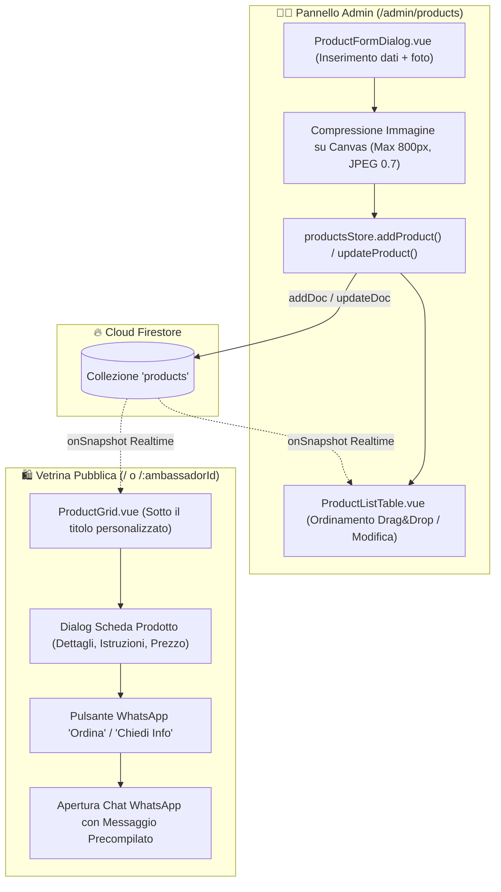

# 📦 Flusso 02 — Gestione Prodotti & Vendita WhatsApp

Questo documento illustra il ciclo completo dei prodotti: dalla creazione e catalogazione nel pannello di amministrazione fino alla visualizzazione pubblica e all'acquisto via WhatsApp.

---

## 📍 Dove si trova il codice

| Elemento | Percorso File | Ruolo Principale |
| :--- | :--- | :--- |
| **Pagina Admin Prodotti** | [src/pages/admin/AdminProducts.vue](file:///home/chif-vas/projects/beauty-ambassador/src/pages/admin/AdminProducts.vue) | Vista principale di gestione catalogo, filtri e pulsante aggiunta. |
| **Tabella Prodotti** | [src/components/admin/ProductListTable.vue](file:///home/chif-vas/projects/beauty-ambassador/src/components/admin/ProductListTable.vue) | Tabella ordinabile con anteprime, prezzi, stock e pulsanti azioni. |
| **Form Creazione/Modifica** | [src/components/admin/ProductFormDialog.vue](file:///home/chif-vas/projects/beauty-ambassador/src/components/admin/ProductFormDialog.vue) | Dialog con campi: nome, prezzo, categoria, istruzioni, caricamento foto. |
| **Store Prodotti** | [src/stores/products.ts](file:///home/chif-vas/projects/beauty-ambassador/src/stores/products.ts) | Operazioni CRUD su Firestore, compressione immagini e calcolo rating. |
| **Griglia Vetrina Pubblica** | [src/components/widgets/ProductGrid.vue](file:///home/chif-vas/projects/beauty-ambassador/src/components/widgets/ProductGrid.vue) | Visualizzazione per i clienti con filtri, popup dettagli e recensioni. |
| **Interazioni Utente** | [src/composables/useProductInteractions.ts](file:///home/chif-vas/projects/beauty-ambassador/src/composables/useProductInteractions.ts) | Gestione Like, Salva nei preferiti, Condividi link e valutazione. |
| **Tipi Dati** | [src/types/product.ts](file:///home/chif-vas/projects/beauty-ambassador/src/types/product.ts) | Definizione TypeScript dell'interfaccia `Product`. |

---

## 🔄 Diagramma di Flusso dei Prodotti

---

## ⚙️ Dettagli Tecnici Chiave

### 1. Compressione Intelligente delle Immagini Client-Side
Per ottimizzare la velocità di caricamento e azzerare i costi di archiviazione Firestore/Storage:
* In `uploadProductImage()` (`src/stores/products.ts`), l'immagine selezionata dall'utente viene caricata in memoria su un elemento `<canvas>`.
* Le dimensioni vengono ridimensionate proporzionalmente a un massimo di **800px**.
* L'immagine viene convertita in formato `image/jpeg` con compressione di qualità **0.7**.

### 2. Sincronizzazione Realtime
* Attraverso `onSnapshot` su Firestore, qualsiasi modifica apportata nel pannello admin (cambio prezzo, nuovo prodotto o disattivazione) viene riflessa istantaneamente su tutti i client connessi senza ricaricare la pagina.
* I prodotti vengono ordinati in base al campo numerico `order` (`(a.order ?? 999) - (b.order ?? 999)`).

### 3. Flusso Vendita & Checkout WhatsApp
1. Nella vetrina pubblica, ogni card prodotto offre il pulsante di contatto o il dialog dettagli.
2. Cliccando su *"Ordina"* o *"Richiedi Consulenza"*, viene generato il link:
   `https://wa.me/<numero>?text=<messaggio_codificato>`
3. Il messaggio include automaticamente il nome del prodotto e il codice promozionale dell'ambassador per una chiusura rapida della vendita.

