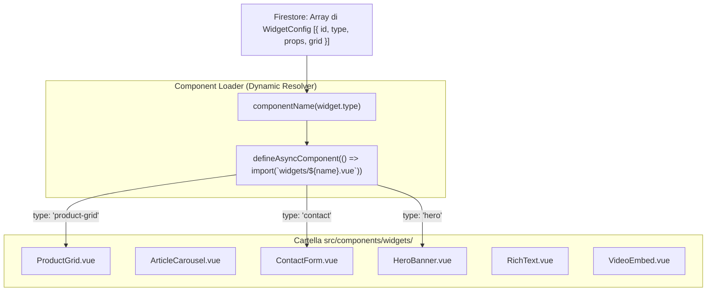

# 🎨 Flusso 05 — Vetrina Pubblica & Page Builder Drag & Drop

Questo documento illustra l'architettura delle pagine pubbliche visualizzate dagli utenti finali e il funzionamento del Page Builder dinamico che consente all'ambassador di comporre visivamente il layout della propria pagina.

---

## 📍 Dove si trova il codice

| Elemento | Percorso File | Ruolo Principale |
| :--- | :--- | :--- |
| **Live Preview & Visual Manager** | [src/pages/admin/AdminPreview.vue](file:///home/chif-vas/projects/beauty-ambassador/src/pages/admin/AdminPreview.vue) | Anteprima live da dashboard con selettore device (Mobile/Tablet/Desktop), ordinamento sezioni e toggle visibilità. |
| **Landing Page Veloce** | [src/pages/LandingPage.vue](file:///home/chif-vas/projects/beauty-ambassador/src/pages/LandingPage.vue) | Vetrina predefinita su `/` ottimizzata per conversione rapida e link social. |
| **Pagina Dinamica Ambassador** | [src/pages/AmbassadorPage.vue](file:///home/chif-vas/projects/beauty-ambassador/src/pages/AmbassadorPage.vue) | Visualizzatore pubblico su `/:ambassadorId` che assembla i widget dal database. |
| **Wrapper Editor** | [src/pages/EditorPage.vue](file:///home/chif-vas/projects/beauty-ambassador/src/pages/EditorPage.vue) | Pagina host su `/:ambassadorId/editor` che attiva la modalità modifica. |
| **Componente Canvas Editor** | [src/components/builder/PageEditor.vue](file:///home/chif-vas/projects/beauty-ambassador/src/components/builder/PageEditor.vue) | Sidebar con elenco widget trascinabili, palette colori e canvas interattivo. |
| **Store Builder** | [src/stores/builder.ts](file:///home/chif-vas/projects/beauty-ambassador/src/stores/builder.ts) | Gestione stato di editing, aggiunta e rimozione widget, salvataggio layout. |
| **Store Ambassador** | [src/stores/ambassador.ts](file:///home/chif-vas/projects/beauty-ambassador/src/stores/ambassador.ts) | Caricamento configurazione layout e profilo da Firestore (`/ambassadors/{id}`). |

---

## 🔄 Architettura di Caricamento Dinamico dei Widget

Sia in [PageEditor.vue](file:///home/chif-vas/projects/beauty-ambassador/src/components/builder/PageEditor.vue) che in [AmbassadorPage.vue](file:///home/chif-vas/projects/beauty-ambassador/src/pages/AmbassadorPage.vue), i singoli componenti della pagina non sono hardcoded, ma vengono caricati **on-demand (Lazy Loading)** tramite `defineAsyncComponent`:

---

## 🧱 Come Funziona il Drag & Drop nel Page Builder

1. **Selezione Widget dalla Sidebar**:
   * Dalla sidebar sinistra dell'editor, l'ambassador vede i widget disponibili (Hero Banner, Griglia Prodotti, Testimonianze, Video, Modulo Contatti).
   * Cliccando su un widget, `builderStore.addWidget(type)` crea una nuova istanza con ID univoco (`uid()`) e proprietà di default.
2. **Riordinamento sul Canvas**:
   * Il canvas utilizza `VueDraggableNext` (basato su `SortableJS`).
   * L'ambassador può afferrare la maniglia `drag-handle` e trascinare le sezioni per cambiare l'ordine verticale della pagina.
3. **Cancellazione e Personalizzazione**:
   * Ogni card ha un pulsante rapido per rimuovere la sezione.
4. **Salvataggio su Firestore**:
   * Cliccando *"Save Layout"*, `builderStore.saveLayout()` persiste l'intero array di configurazione nel documento:
     `/ambassadors/{ambassadorId}/config/layout`
5. **Visualizzazione Finale**:
   * Quando un visitatore apre `/:ambassadorId`, [AmbassadorPage.vue](file:///home/chif-vas/projects/beauty-ambassador/src/pages/AmbassadorPage.vue) scarica il layout salvato e renderizza istantaneamente la pagina personalizzata.
