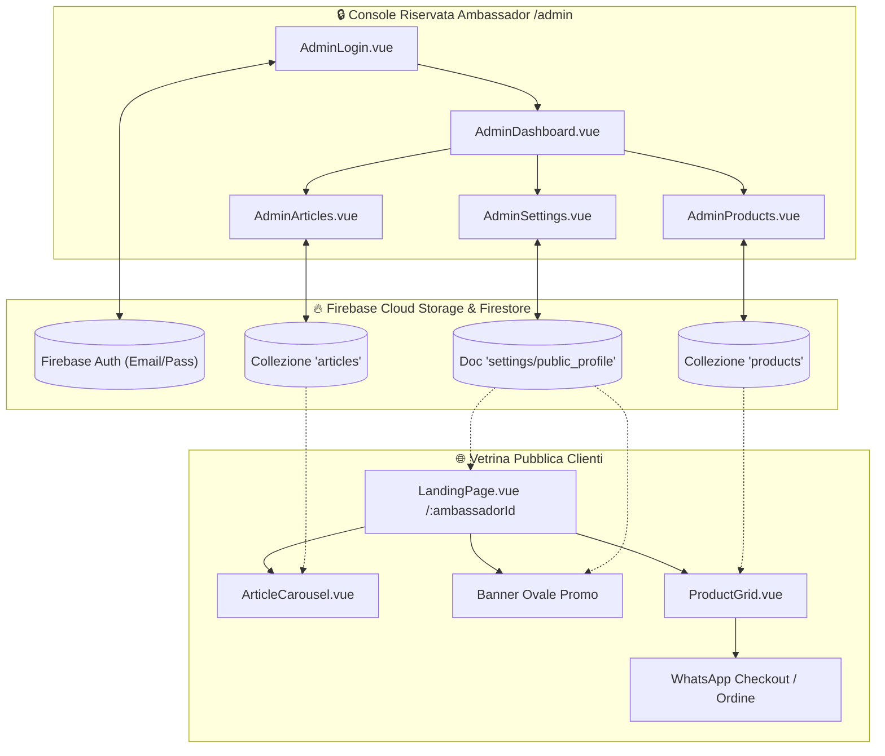

# 🧠 FlowLogic — Documentazione dei Flussi e Architettura

Benvenuto nella directory `flowLogic/`. Questa cartella rappresenta la **guida operativa e tecnica** del progetto Beauty Ambassador (GlowAndCareSpace) per la piattaforma **Elara**.
Ogni file descrive un modulo specifico: come funziona, quali componenti e store coinvolge, dove sono salvati i dati su Firebase e come si collegano tra di loro.

---

## 📑 Indice dei Flussi

| File | Modulo | Descrizione |
| :--- | :--- | :--- |
| **[01_auth_flow.md](file:///home/chif-vas/projects/beauty-ambassador/flowLogic/01_auth_flow.md)** | **Autenticazione & Sessione** | Login, Logout, Router Guards, Ripristino Sessione e Sicurezza. |
| **[02_products_flow.md](file:///home/chif-vas/projects/beauty-ambassador/flowLogic/02_products_flow.md)** | **Gestione Prodotti & Vendita WhatsApp** | CRUD Prodotti, Compressione Immagini, Ordinamento e Checkout WhatsApp. |
| **[03_articles_flow.md](file:///home/chif-vas/projects/beauty-ambassador/flowLogic/03_articles_flow.md)** | **Articoli & Carosello Hero** | Gestione storie/consulenze e carosello ad alto impatto (Mobile & Desktop). |
| **[04_settings_vetrina_flow.md](file:///home/chif-vas/projects/beauty-ambassador/flowLogic/04_settings_vetrina_flow.md)** | **Impostazioni, Branding & Banner** | Profilo, Colori dinamici, Titoli vetrina, Banner Promozionale e QR Code. |
| **[05_public_pages_builder_flow.md](file:///home/chif-vas/projects/beauty-ambassador/flowLogic/05_public_pages_builder_flow.md)** | **Vetrina Pubblica & Page Builder** | Pagine pubbliche dei clienti, Caricamento Widget dinamici e Page Editor. |
| **[06_file_map_reference.md](file:///home/chif-vas/projects/beauty-ambassador/flowLogic/06_file_map_reference.md)** | **Mappa dei File ("Cosa trovi e dove")** | Guida rapida e mappatura file-per-file di tutta la codebase. |

---

## 🏛️ Visione Architetturale d'Insieme

